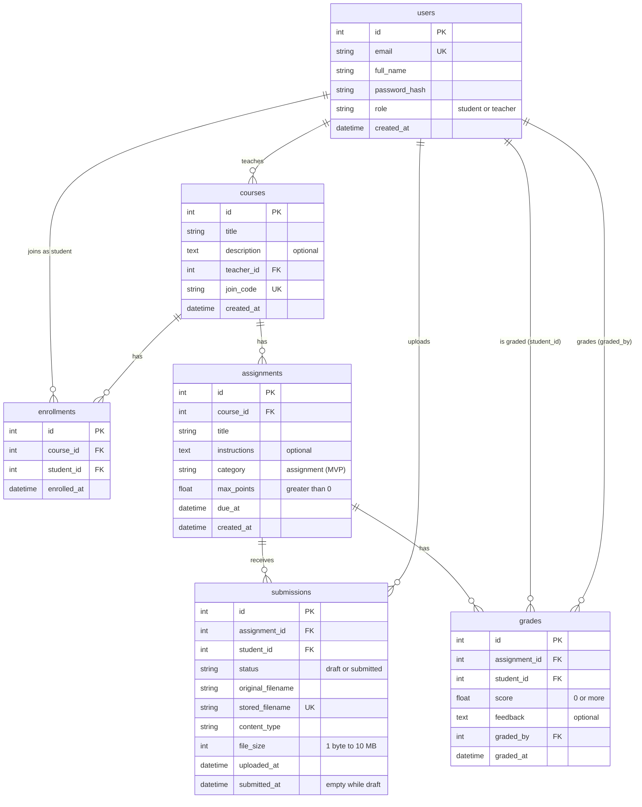

# Database Relationship Diagram

This diagram shows every ClassFlow table, its columns and how the tables link together.
It matches the models in [`backend/app/models.py`](../backend/app/models.py).

## How to read it

- **PK** (primary key): the unique id of each row.
- **FK** (foreign key): must match an existing row in the linked table.
- **UK** (unique key): no two rows may have the same value.
- `||--o{` means **one to many**. For example, one course has zero or more assignments.

## Rules the diagram doesn't show

| Table | Rule | Why |
|---|---|---|
| enrollments | UNIQUE(course_id, student_id) | A student can't join the same course twice |
| submissions | UNIQUE(assignment_id, student_id) | One submission per student per assignment |
| submissions | status = 'submitted' needs submitted_at | We always know when work was turned in |
| grades | UNIQUE(assignment_id, student_id) | One grade per student per assignment |
| courses → enrollments, assignments | ON DELETE CASCADE | Deleting a course removes its enrollments and assignments |
| assignments → submissions, grades | ON DELETE CASCADE | Deleting an assignment removes its submissions and grades |
| any FK → users | no cascade | A user who still owns data can't be deleted |

**Many-to-many:** students and courses are linked through `enrollments`. One student can join many courses, and one course has many students.

**Why `grades` is separate from `submissions`:** some work, like an on-campus midterm (added later), gets a grade without any uploaded file.

## Checked in code, not in the database

- A course's `teacher_id` must belong to a user with role `teacher`.
- Only students enrolled in a course can submit to its assignments.
- `score` can't be greater than the assignment's `max_points`.
- No resubmitting after a grade exists.

## Tables added later with their features

- `topics`: the course topic tree. `parent_id` points to another topic.
- `topic_prerequisites`: the prerequisite graph between topics.
- `grade_changes`: the undo stack for grade edits.
