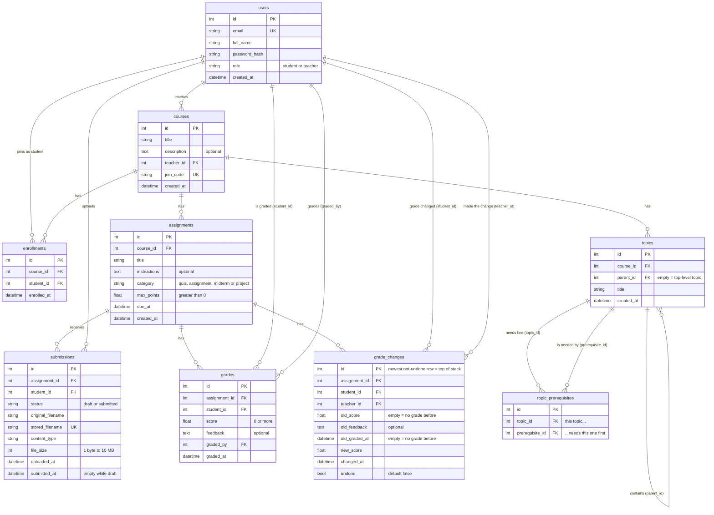

# Database Relationship Diagram

This diagram shows every ClassFlow table, its columns and how the tables link together.
It matches the models in [`backend/app/models.py`](../backend/app/models.py).

## How to read it

- **PK** (primary key): the unique id of each row.
- **FK** (foreign key): must match an existing row in the linked table.
- **UK** (unique key): no two rows may have the same value.
- `||--o{` means **one to many**. For example, one course has zero or more assignments.

## Rules the diagram doesn't show

| Table | Rule | Why |
|---|---|---|
| enrollments | UNIQUE(course_id, student_id) | A student can't join the same course twice |
| submissions | UNIQUE(assignment_id, student_id) | One submission per student per assignment |
| submissions | status = 'submitted' needs submitted_at | We always know when work was turned in |
| grades | UNIQUE(assignment_id, student_id) | One grade per student per assignment |
| courses → enrollments, assignments | ON DELETE CASCADE | Deleting a course removes its enrollments and assignments |
| grade_changes | old_score and new_score are 0 or more (old_score may be empty) | No negative scores in the history either |
| assignments | category IN ('quiz', 'assignment', 'midterm', 'project') | Fixed weights 10 / 10 / 30 / 50 (in `app/scoring.py`) |
| topic_prerequisites | UNIQUE(topic_id, prerequisite_id), topic_id ≠ prerequisite_id | No duplicate arrows, and a topic can't need itself |
| topics → topic_prerequisites (both columns) | ON DELETE CASCADE | Deleting a topic removes every arrow to or from it |
| courses → topics, topics → subtopics | ON DELETE CASCADE | Deleting a course removes its topics; deleting a topic removes its subtopics |
| assignments → submissions, grades, grade_changes | ON DELETE CASCADE | Deleting an assignment removes its submissions, grades and grade history |
| any FK → users | no cascade | A user who still owns data can't be deleted |

**Many-to-many:** students and courses are linked through `enrollments`. One student can join many courses, and one course has many students.

**Why `grades` is separate from `submissions`:** some work, like the in-class midterm, gets a grade without any uploaded file.

**No results table:** course percentages, letters and statistics are worked out from `grades` each time they are shown,
so they can never be out of date.

**The topic tree:** `topics` links to itself. Each topic stores only its parent's id, and the API builds the nested tree from that flat list.

**Two different structures on `topics`:** `parent_id` makes a **tree** (each topic has at most one parent, used for folders).
`topic_prerequisites` makes a **graph** (a topic can need many topics and be needed by many), and it must have no loops.

**Why `grade_changes` points at assignment + student, not at `grades.id`:** undoing a first grade deletes the grade row, and a link to a deleted row would break. Each teacher's undo stack is simply their own rows, newest first.

## Checked in code, not in the database

- A course's `teacher_id` must belong to a user with role `teacher`.
- Only students enrolled in a course can submit to its assignments.
- `score` can't be greater than the assignment's `max_points`.
- A topic's parent must be in the same course, and a topic can't be moved inside itself or one of its own subtopics (no loops).
- Both topics of a prerequisite arrow must be in the same course, and an arrow that would make a loop
  (A needs B needs … needs A) is refused. Checked with `app/graph.py`.
- No resubmitting after a grade exists.
- A midterm is taken in class: no uploads, and work with uploads can't be switched to midterm.

